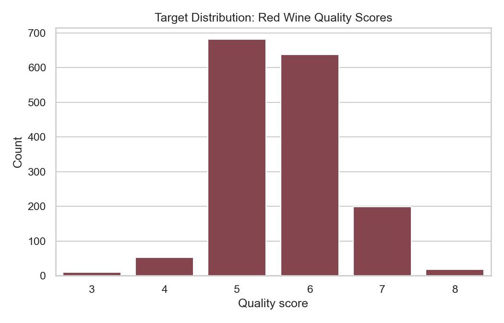
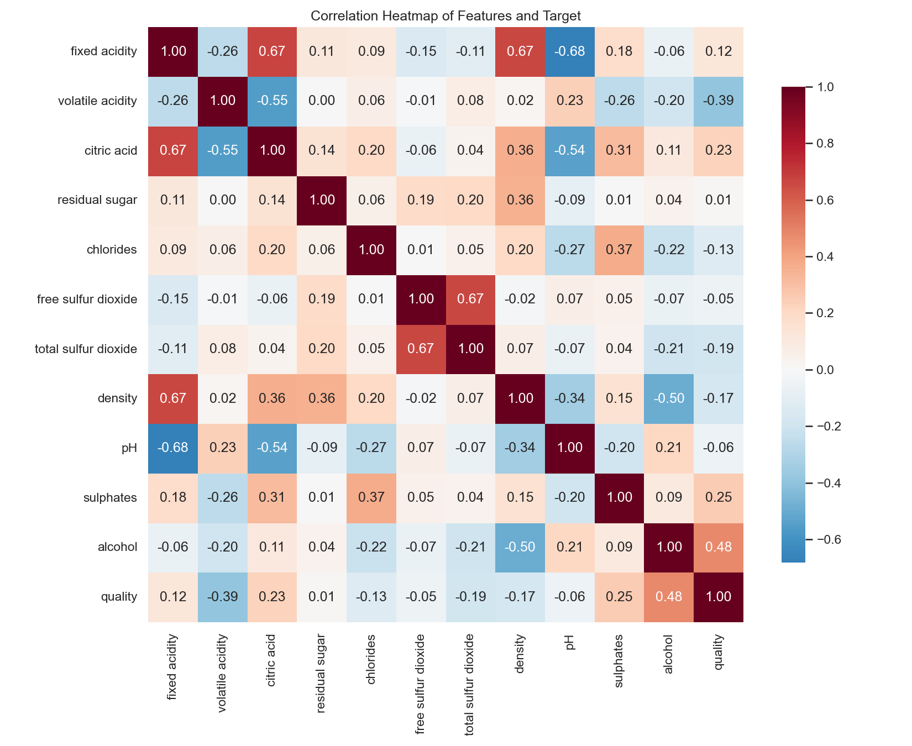
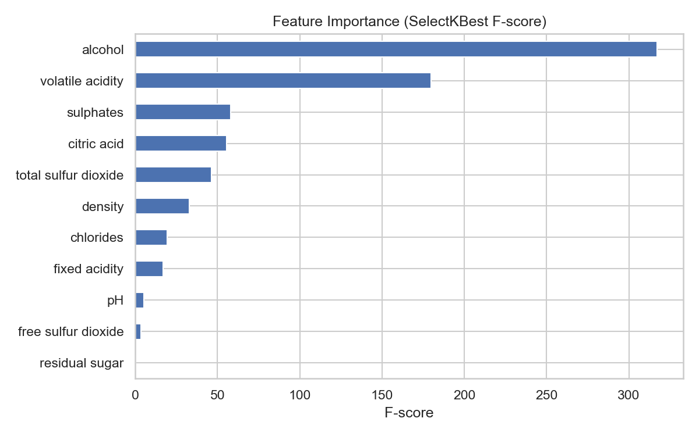
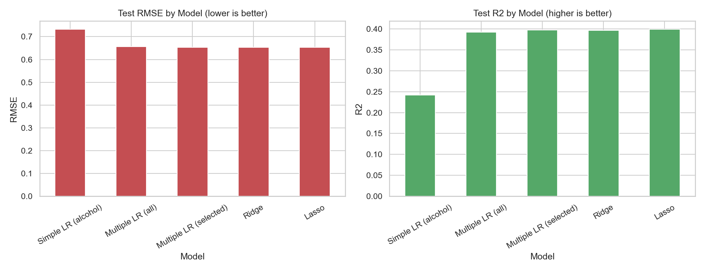
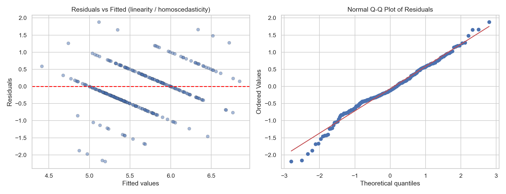
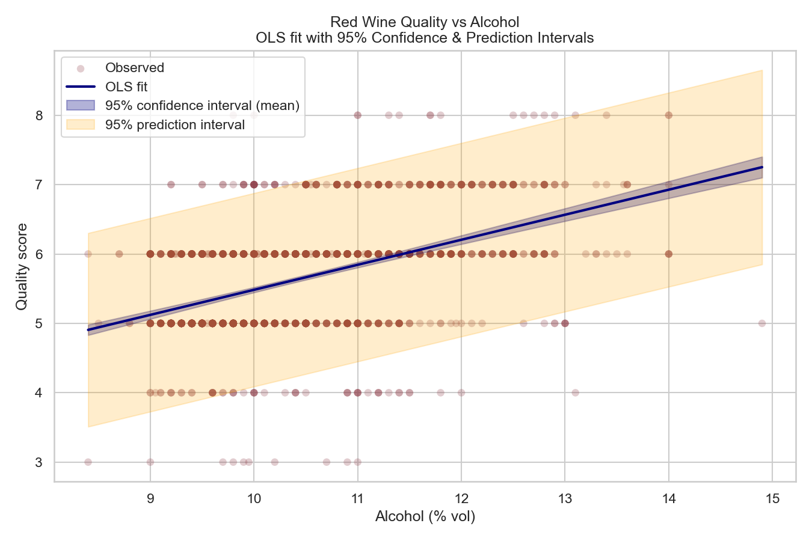
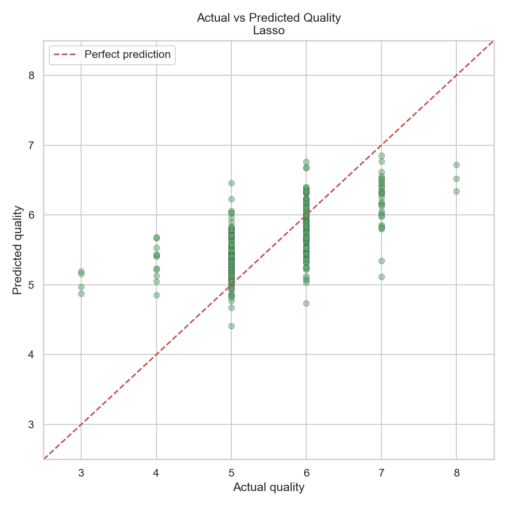

# AIoT HW2 報告 — 紅酒品質之線性回歸預測

**課程：** AIoT　**作業：** HW2　**學號：** 7114056032
**日期：** 2026/10/14

> 本報告依 CRISP-DM 流程撰寫，並明確標示「GPT 輔助內容」與「NotebookLM 研究摘要」。
> 轉存 PDF 建議：以 VS Code / Typora 開啟本檔 → 匯出 PDF，或使用 pdfCrowd。

---

## 一、資料集來源與研究脈絡

- **資料集：** Red Wine Quality (Cortez et al., 2009)
- **來源連結：** <https://www.kaggle.com/datasets/uciml/red-wine-quality-cortez-et-al-2009>
- **原始出處：** UCI Machine Learning Repository；論文 P. Cortez, A. Cerdeira, F. Almeida,
  T. Matos, J. Reis, *Modeling wine preferences by data mining from physicochemical
  properties*, Decision Support Systems, 47(4):547–553, 2009.
- **規模：** 1,599 筆樣本、11 個理化特徵、1 個品質目標（0–10 分）。
- **研究脈絡：** 葡萄酒品質傳統上靠專業品評師主觀評分，成本高且不易規模化。
  本研究探討是否能僅以客觀理化檢測（酸度、糖分、酒精、二氧化硫等）預測品質分數，
  屬經典的迴歸教學資料集，常用於示範特徵選擇、正則化與回歸假設檢驗。

---

## 二、CRISP-DM 分析流程

### 1. Business Understanding（商業理解）
目標是建立一個可用 11 項理化檢測預測紅酒品質分數的回歸模型。
對釀酒廠而言，這能以低成本、客觀的實驗數據輔助品質管控，
降低對昂貴主觀品評的依賴。成功準則：模型可執行、具合理的 R² 與 RMSE，
並能解釋哪些理化性質最影響品質。

### 2. Data Understanding（資料理解）
- 資料 1,599 筆、12 欄，**無缺失值**。
- 目標分數集中於 5、6 分，為不平衡分佈，極端分數（3、8）樣本稀少。
- 與品質相關性最高：`alcohol`(+0.48)、`volatile acidity`(−0.39)、`sulphates`(+0.25)；
  `residual sugar`、`free sulfur dioxide`、`pH` 幾乎無線性相關。

### 3. Data Preparation（資料準備）
- 移除 240 筆完全重複列 → 1,359 筆。
- 80/20 切分訓練 / 測試集（`random_state=42`，確保可重現）。
- `StandardScaler` 標準化，**僅以訓練集 fit**，再套用到測試集，避免資料洩漏。

### 4. Feature Selection（特徵選擇）
採三種互補方法，取「至少被 2 種方法選中」的共識特徵：

| 方法 | 原理 |
|------|------|
| SelectKBest (f_regression) | 單變量 F 檢定，衡量各特徵與目標的線性關聯 |
| RFE (LinearRegression) | 遞迴消除貢獻最小的特徵 |
| LassoCV (L1) | 正則化讓不重要特徵係數歸零 |

共識特徵（9 個）：fixed acidity、volatile acidity、citric acid、chlorides、
free sulfur dioxide、total sulfur dioxide、pH、sulphates、alcohol
（被剔除：residual sugar、density）。

### 5. Modeling（建模）
訓練 5 個模型：單純線性回歸（僅 alcohol）、多元線性回歸（全特徵）、
多元線性回歸（選擇後 9 特徵）、Ridge、Lasso。

### 6. Evaluation（評估）
指標：MAE、MSE、RMSE、R²、Adjusted R²、5-fold CV R²。

| Model | n_feat | MAE | MSE | RMSE | R² | Adj_R² | CV_R² |
|-------|:---:|---:|---:|---:|---:|---:|---:|
| Simple LR (alcohol) | 1 | 0.5675 | 0.5368 | 0.7327 | 0.2421 | 0.2393 | 0.2171 |
| Multiple LR (all) | 11 | 0.5041 | 0.4310 | 0.6565 | 0.3915 | 0.3658 | 0.3209 |
| Multiple LR (selected) | 9 | 0.5032 | 0.4272 | 0.6536 | 0.3969 | 0.3762 | 0.3269 |
| Ridge | 11 | 0.5038 | 0.4276 | 0.6539 | 0.3964 | 0.3709 | 0.3223 |
| **Lasso** | 11 | **0.5015** | **0.4257** | **0.6525** | **0.3990** | **0.3736** | **0.3263** |

**觀察：**
- 單純線性回歸 R²=0.242；加入多特徵後 R² 提升到約 0.40，說明品質由多因素共同決定。
- 特徵選擇後的 9 特徵模型 **Adjusted R²（0.376）優於全特徵（0.366）**，剔除雜訊有效。
- Lasso 綜合表現最佳（RMSE 最低、R² 最高）。

**回歸假設檢驗：** 殘差 vs 擬合值大致隨機分佈、Q-Q 圖接近直線，
顯示線性與常態假設大致成立；因目標為離散整數，殘差呈現分層帶狀屬正常現象。

**預測圖（含信賴 / 預測區間）：**
下圖以 `quality ~ alcohol` 的 OLS 擬合，繪出 95% 信賴區間（迴歸線平均值，窄帶）
與 95% 預測區間（個別觀測值，寬帶）。可見酒精濃度與品質正相關，
但單一特徵的預測區間很寬，呼應需要多元特徵才能提升準確度。

### 7. Deployment（部署）
- 標準化係數顯示：`alcohol`(+0.31)、`volatile acidity`(−0.17)、`sulphates`(+0.14)
  為最具影響力的因子，符合領域知識（酒精與硫酸鹽提升品質、揮發酸降低品質）。
- 以 5 筆未見樣本示範批次預測。
- 實務部署會將「模型 + StandardScaler」以 `joblib` 序列化，封裝成 REST API
  或批次工作，對新酒款理化數據即時評分，並定期以新資料重新訓練。

---

## 三、GPT 輔助內容

> **以下為 GPT 輔助內容（AI-assisted）。完整 ChatGPT 對話需另以 pdfCrowd 匯出為 PDF 附於繳交檔。**

本次作業在下列環節使用 ChatGPT 作為輔助：

1. **選題與資料集篩選。** 詢問 GPT「列出 Kaggle 上特徵數介於 10–40 的多元線性回歸題目」，
   取得候選清單（Flood Prediction、House Prices、Red Wine Quality 等），最終選定
   特徵數 11、無缺失值、適合教學的 Red Wine Quality。
2. **CRISP-DM 架構。** 請 GPT 說明六大階段應包含的工作項目，據此規劃程式結構。
3. **特徵選擇與評估方法。** 請 GPT 比較 SelectKBest、RFE、Lasso 的差異，
   並確認 Adjusted R² 與 5-fold 交叉驗證的計算方式。
4. **信賴區間 vs 預測區間。** 請 GPT 釐清兩者差異（前者估計平均反應、後者估計單一觀測），
   並確認以 `statsmodels` 的 `get_prediction().summary_frame()` 取得兩種區間。

> ⚠️ 繳交時請將上述實際的 ChatGPT 對話畫面，透過 pdfCrowd（或瀏覽器列印成 PDF）匯出，
> 命名後與本報告一併壓縮上傳。本章僅為對話重點整理。

---

## 四、NotebookLM 研究摘要

> **以下為 NotebookLM 摘要（針對網路上同主題解法彙整，約 160 字）。**

針對「紅酒品質預測」此一主題，透過 NotebookLM 匯整多篇 Kaggle Notebook 與教學文章後可歸納：
多數作者先進行探索性資料分析（EDA），觀察到 alcohol、volatile acidity、sulphates 是最具預測力的特徵，
且目標分數高度集中於 5–6 分而呈不平衡。前處理上普遍採標準化與去重複，並以 train/test 切分避免過擬合。
在建模策略上，純線性回歸的 R² 約落在 0.35–0.40，為基準線；進一步採用 Ridge/Lasso 正則化可小幅改善並防止過擬合。
社群的共識是：線性模型雖具高度可解釋性，但受限於特徵與目標間的非線性關係，表現有上限；
改用隨機森林、梯度提升（XGBoost/LightGBM）等集成模型，R² 常可提升至 0.45–0.55。
部分作者也將任務改為分類（好 / 普通 / 差）以提高可用性。整體研究脈絡顯示：
特徵選擇與正則化是穩健基準，非線性集成模型則是追求更高準確度的主流進階解法。

---

## 五、主流 / 更優解法之比較

| 方法 | 代表作法 | 典型表現 (R²) | 優點 | 缺點 |
|------|----------|:---:|------|------|
| 單純線性回歸 | quality ~ alcohol | ~0.24 | 最易解釋 | 準確度低 |
| 多元線性回歸 | 全特徵 OLS | ~0.39 | 可解釋、快速 | 無法捕捉非線性 |
| Ridge / Lasso（本作業最佳） | L2 / L1 正則化 | ~0.40 | 防過擬合、Lasso 可自動選特徵 | 仍為線性假設 |
| 隨機森林 | RandomForestRegressor | ~0.45–0.50 | 捕捉非線性與交互作用 | 可解釋性差 |
| 梯度提升 | XGBoost / LightGBM | ~0.48–0.55 | 普遍最高準確度 | 需調參、較易過擬合 |
| 改為分類任務 | 二元/三元分類 + 集成 | Acc ~0.70–0.90 | 貼近實務「好酒 / 普通」判斷 | 損失連續資訊 |

**結論：** 在「可解釋性」與「教學目的」下，正則化線性回歸（Lasso）是穩健且合理的基準，
本作業結果（R²≈0.40、RMSE≈0.65）與文獻中線性模型表現一致。
若以「追求最高準確度」為目標，主流更優解法為梯度提升樹，可將 R² 提升約 0.1。
未來可延伸：加入多項式/交互特徵、處理類別不平衡、或改以分類框架評估。

---

## 六、Kaggle 名次 / 結果呈現

本資料集為開放教學資料（非積分競賽），無排行榜名次，
故以「預測圖 + 評估指標」作為成果呈現：
最佳 **Lasso** 模型於測試集達 **R²≈0.399、RMSE≈0.653、MAE≈0.502**，
並附殘差診斷與 95% 信賴 / 預測區間圖佐證模型合理性。

---

## 附錄：執行環境

- Python 3（Anaconda 發行版）
- pandas / numpy / scikit-learn / matplotlib / seaborn / scipy / statsmodels
- 執行：`python 7114056032_hw2.py`，輸出於 `results/`。
